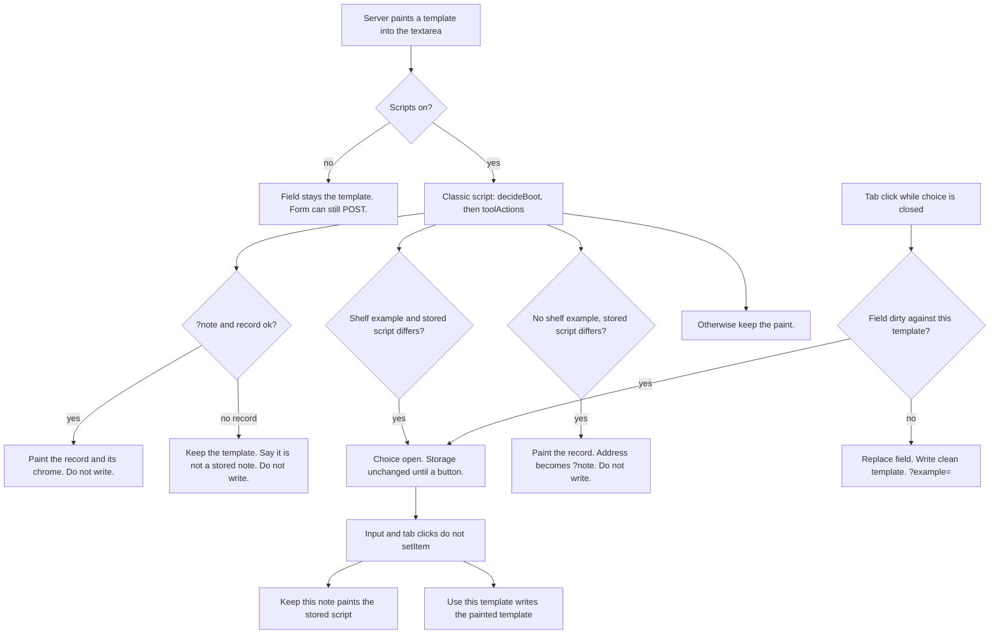
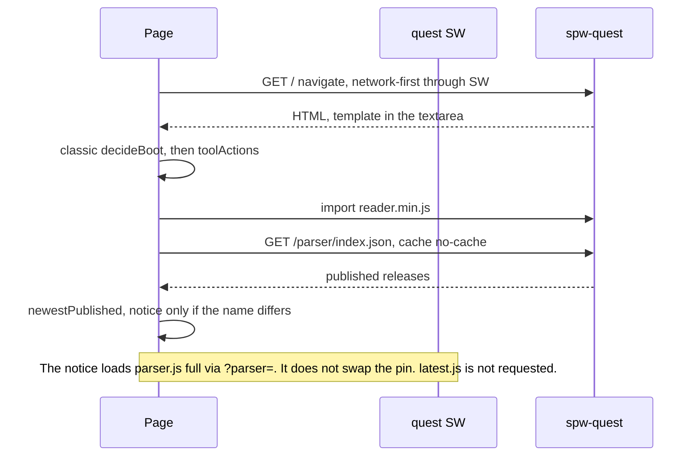

> Received 2026-10-14 from the creator as a draft written by another model (grok-design-doc-19d1e865.md), kept here verbatim, but for one workbench command written from the site root, as the design of record for spw.quest's note and shell. PR 1 (the note) has landed; where it departs from this text, and why, is in `wip.spw` (2026-10-14 entries). The example ids it names (`decision`, `commit`, `garden.spw`) predate commit 500c548b: they are now `persona`, `revision` and `reading-log.spw`.

# spw.quest note, then shell

| | |
|---|---|
| Author | _unassigned_ |
| Date | 2026-10-14 |
| Status | Draft |
| Scope | `workers/spw-quest` only. Same Cloudflare script `spw-quest`. Not a new repository. Not the spwashi.com service worker. |

## Overview

spw.quest is a guide whose editor is a textarea. A tab click runs `liveFile` in `workers/spw-quest/src/file-reader.js` and replaces that textarea with one of the five `EXAMPLES`. A reload asks `handleQuest` for the page again, and the worker paints the example back from `exampleById`. The text the person typed is gone. Copy, Download, and the scripts-off submit already treat the textarea as the source of truth. Nothing else does.

A service worker installed in front of that guide would be a second cache of the template. The homepage is about 85 KB of HTML (`public, max-age=120`) with `EXAMPLES[0]` already inside the textarea. Caching that response at install and calling it the app would make a reload look durable while still restoring `garden.spw`.

This design lands one device note first, then a shell around it. The note is one record in the page's `localStorage`. The service worker never sees it. The shell precaches a pinned parser reader, the two paper faces, and a small `/offline` document. It does not precache `/`. HTML stays network-first in a pages cache that fills only after a successful navigation. A newer parser release is a name the page can show, not a file the worker swaps in. Installability falls out of that shell. It does not add an account, a sync path, or a promise that an unstored note can be edited offline. A first offline launch with an empty pages cache gets `/offline`, not the notebook.

## Background & Motivation

### What the worker is today

`workers/spw-quest/wrangler.jsonc` names the script `spw-quest`, points `main` at `src/index.js`, sets `workers_dev` and `preview_urls` to false, and lists no routes. Zone routes serve it. Deploy remains:

```
npx wrangler deploy --config workers/spw-quest/wrangler.jsonc
```

A successful upload can still print "No targets deployed". Do not add routes to fix that sentence. `assets.run_worker_first` is true. The worker returns its own `Response` on every path. Parser files and fonts become public only because `handleParser` and `servePeerFont` call `env.ASSETS.fetch` and set headers. A file dropped in `assets/` is not on the internet until a branch does that.

`handleQuest` in `src/index.js` paints `/` from `renderGuide`. `?example=` selects a member of `EXAMPLES` (`notebook`, `question`, `decision`, `reading`, `commit`). An unknown id falls through to `EXAMPLES[0]`. Measured on 2026-10-14 with no assets binding, `GET /` and `GET /?note` are the same 85,180-byte document: the server ignores `note`. `GET /?example=commit` is 85,308 bytes. `GET /learn` is 77,231. `GET /build` is 85,581 and is cached `public, max-age=300`. `POST /build` and `GET`/`POST /script.spw` are `no-store`. `GET /` varies on `Accept`. `routes.test.mjs` requires `text/plain` and `quest.v2` JSON for the same path. `*/*` still renders HTML today because `wantsJson` requires `application/json` and the plain-text branch requires `text/plain` or `text/markdown`. That is an accident of `handleQuest`, not a cache contract.

The file surface is `fileWorkspace`. The form is `method="post"` `action="/build#build"`. Download is a submit button with `formaction="/script.spw"`. "Open in the editor" submits `tool=read`. `editorField` renders a paint `<pre>` and a `<textarea id="script" name="script" maxlength="65536">`. `FILE_LIMIT` in `file-reader.js` and `MAX_SCRIPT` in `build.js` are both 65,536. `toolActions` reads `form[data-file]` for Copy (`[data-tool="copy"]`), the ⌘/Ctrl+Enter submit (`[data-tool="read"]`), and a blob Download on `[data-tool="download"]`. That download query is null. The guide button in `fileWorkspace` and the `/build` button in `build.js` are both `<button type="submit" name="tool" value="download" formaction="/script.spw">`, with no `data-tool`. `preventDefault` never runs. With scripts on, Download navigates a POST to `/script.spw`. Scripts off, that same POST is the only path, and it must stay the path. Copy is hidden when scripts are off (`html:not(.js) [data-tool="copy"]` in `page.js`).

`liveFile` is shipped by `Function#toString` from `liveFileScript`. On `click` of `[data-example]` it assigns `field.value = example.script` and `history.replaceState` to `?example=<id>#try`, dropping every other query key. Modified clicks (meta, ctrl, shift) are left as real navigations. There is no dirty check.

`layout` in `workers/lib/shell.js` puts the guide body, including the `<script type="module">` from `liveFileScript`, inside `<main>`. Then a classic script adds `class="js"`. Then a second classic script runs the `script` argument. `renderGuide` passes `toolActions` as that argument. A module waits for its import graph. The classic script at the end of `<body>` runs when the parser reaches it, and `toolActions` binds Copy and the read submit before the module's `import { parse }` resolves. The blob listener is in that same function and does not attach, because no button carries `data-tool="download"`.

Pages that read as you type use `LIVE_CSP` in `src/page.js`. Measured on `GET /`:

```
default-src 'none'; style-src 'unsafe-inline'; font-src 'self'; script-src 'self' 'unsafe-inline'; base-uri 'none'; form-action 'self'; frame-ancestors 'none'; upgrade-insecure-requests
```

That is `PAGE_CSP` with `script-src 'self' 'unsafe-inline'`. `PAGE_CSP` is `BASE_SECURITY` in `workers/lib/shell.js` plus `font-src 'self'`. Routes: `/`, `/learn`, and `/build` are `LIVE_CSP` (`test/routes.test.mjs`). `/install` and `/read` use `PAGE_CSP`, whose `script-src` is only `'unsafe-inline'`. `connect-src` and `manifest-src` are absent, so both fall back to `default-src 'none'` (CSP Level 3). `img-src` falls back the same way. `layout` adds `class="js"` from an inline classic script. `htmlResponse` defaults HTML to `public, max-age=120`.

### Two parsers, on purpose

`/parser.js` is the site bundle. `carry-parser.mjs` copies `public/js/semantic/spw-workbench-parser.js` into `src/parser-text.js`. The stamp says `npm run build:spw-parser`. The response is `public, max-age=3600`. Measured size 75,779 bytes. `liveFileScript` and `liveScript` (`src/reader.js`, used by `/learn`) both import `parse` from that URL. `readFile` on the worker imports the same module from the repo path, so scripts-off readings use it too.

A dated release is a different build. `npm --prefix .spw/_workbench run bundle:parser`, carried by `carry-parser-release.mjs`. `assets/parser/2026.10.13/manifest.json` lists `reader.min.js` at 87,605 bytes (`sha256` `9928ec7f51a0416ee39857dc3a3b236d071051f484e4da5a3460a8f62c5d4de7`), `full.min.js` / `parser.js` at 75,850, `lite.min.js` at 3,206, `workbench.min.js` at 425,588. `reader.min.js` exports `parse`, `highlightHtml`, `outline`, `anchors`, `roles`, `parseExpression`, `SPW_PARSER_BUILD`. Dated files are served with `IMMUTABLE` (`public, max-age=31536000, immutable`) from `src/parser-releases.js`. A published day is cut once. A fix is `YYYY.MM.DD-patch.N`. `2026.10.13` was recut in place anyway. Commit `7d027f49` published the release-day build from workbench revision `76e17bd`. Commit `c8365578` cut the same day again in place from workbench revision `0eb1d1c` ("nobody fetched it"). `0eb1d1c0e454` is the current `manifest.json` / `quest.js` pin, not the previous bytes. `76e17bd` and `0eb1d1c` are workbench revisions, not commits in this repo. An immutable URL is not "latest".

`GET /parser/index.json` is the published list (`schema` `spw.parser-index/2`), served with `SHORT` (`public, max-age=300`) via `serveFile`. `indexJson`'s `max-age=60` is the prerelease index, not this file. `carry-parser-release.mjs` writes the published list `newestFirst`. That array order is not a contract the page may trust. `GET /parser/latest.js` is a 302 to `/parser/<newest>/parser.js` (not to `reader.min.js`) with `max-age=300`. It is for trying a release, not for importing one. Never a prerelease. Prereleases live in `prereleases.json` and `/parser/next.js`. They are not published.

`?parser=` (`parserSwitch`, `switchLoader`) already loads one named build in the guide and falls back to `/parser.js`. `switchModulePath` / `DEFAULT_FILE` is `parser.js`, the alias of `full.min.js`. The worker's own readings ignore `?parser=`.

On the five `EXAMPLES`, `parse` from the site bundle, from `reader.min.js`, and from `full.min.js` produced the same token streams on 2026-10-14 (same `success`, AST type `Seed`). `lite.min.js` exports `scan` only. It does not export `parse`.

### The other service worker

`/sw.js` at the repo root, registered by `public/js/runtime/shell/pwa-update-handler.js` with `{ updateViaCache: 'none' }`, controls spwashi.com only. That handler's message type is `SKIP_WAITING`. The quest worker keeps its own type, `skip-waiting`. `npm run check:pwa` asserts the repo-root file and `manifest.webmanifest`. This design does not edit either, does not precache quest URLs into the site worker, and does not register the site worker on spw.quest. The quest worker is a different origin. Its script will be `https://spw.quest/sw.js`, served by `spw-quest`. The site manifest's `share_target` and `file_handlers` are not copied. `public/sw.js` is `importScripts('/sw.js')` for the site, not this worker.

### Pain

- A reload restores a template. The guide describes notes and then refuses to keep one.
- The five examples are the only files, and a click discards edits.
- Putting the script in the query, which `/build?script=` already does up to `SHARE_MAX` (1,800), sends the text to the server and into any cache that keys on the full URL.
- A cache-first shell of `/` would freeze both the guide copy and the template, and would treat the immutable reader URL as fresh if it ever followed `latest.js`.

## Goals & Non-Goals

### Goals

1. One open note on the device. It survives a reload. It has an address. A template does not replace it without a dirty check, and nothing writes over it while that check is still on screen.
2. The textarea stays the source of truth. Copy reads it. On the guide, scripts-on Download saves a blob from it and does not navigate. Scripts-off Download still posts `formaction="/script.spw"`. No new POST. Copy and the blob listener are bound only after boot has painted the field.
3. A service worker at `https://spw.quest/sw.js` whose precache is the shell (pinned reader, two faces, `/offline`), not `/`, not the note, and not `workbench.min.js`.
4. HTML network-first, in one pages cache, only for navigations. Parser pin by release name plus sha256 of the bytes that are stored. `index.json` checked on open, which means the document policy allows that fetch. A newer name is announced. The worker script updates and rolls back without deleting the note.
5. Installability as a consequence: manifest link the document is allowed to fetch, scope, icons, `display`. Offline editing only when a note is already stored and a successful navigation has already filled the pages cache for that URL.

### Non-goals

- A second note, a list, rename-as-a-feature, or sync. No account. No cookie. No IndexedDB. `navigator.storage.persist()` is not in these four PRs.
- Redesigning `/build` or `/learn` into the note. They stay. `/build` still receives the textarea when the person submits the existing form.
- Replacing `fileKit`'s paint and outline with `reader.min.js`'s `highlightHtml` / `outline`. The pin is the `parse` the guide imports, and the file the shell stores. The reading markup stays `fileKit`.
- Precaching `/`, `workbench.min.js`, debug builds, source maps, `lite.min.js`, `full.min.js`, dated `parser.js`, or the moving `/parser.js`.
- Treating `/parser/latest.js` or an immutable URL as the current pin.
- An install button, `share_target`, or `file_handlers`. The site manifest at `manifest.webmanifest` is a different origin and a different product. Do not copy those fields.
- Editing `workers/lib/shell.js` `layout`, or putting quest directives on `BASE_SECURITY`. autonomous.feedback uses that shell. Quest policy stays in `page.js`. The boot script is the `script` argument quest already passes into `layout`.
- A new npm package. A new wrangler route. A dependency on the live version id `5e870c3b-4436-4cc2-9379-bd37b9311c1f`.
- Forking `?parser=` so the notice loads `reader.min.js`. The existing switch stays.

## Proposed Design

### 1. The note

New module `workers/spw-quest/src/note.js`. Pure functions only. They must not close over imports. `liveFileScript` will paste them into the page with `toString`, the same way `fileKit` and `liveFile` already travel. Unit tests import the functions. The page runs the same source. `liveFile` itself must not call `note.js` by import: that binding does not exist in the browser.

#### Record

Storage is `localStorage`, key `spw.quest.note/1`. One key, one note. The service worker has no `localStorage`, so it cannot cache the body. Do not also write the body to Cache Storage, IndexedDB, a cookie, or the query string.

```json
{
  "schema": "spw.quest.note/1",
  "id": "local",
  "filename": "garden.spw",
  "script": "#>garden_log\n",
  "from": "notebook",
  "savedAt": 1728877020000
}
```

| Field | Rule |
|---|---|
| `schema` | Exactly `spw.quest.note/1`. Anything else is not restored and is not deleted. A later schema can read it. |
| `id` | Exactly `local`. |
| `script` | String, sliced to `FILE_LIMIT` (65,536) before save and before restore. |
| `filename` | Passed through the same rules as `safeName` in `build.js`: one segment, `.spw`, at most 80 characters of the cleaned base. Default `line.spw` only if the cleaned base is empty. |
| `from` | An `EXAMPLES` id, or `null` once the text no longer equals that template. |
| `savedAt` | `Date.now()`. Not shown. Used so a `storage` event from another tab can be ordered. |

The cap is `FILE_LIMIT`, not a second budget. `JSON.stringify` of a 65,536-character script is larger than that script's UTF-16 size when the text contains quotes or control characters. The record is still far under a 5 MiB origin quota. Do not cite "~128 KiB" as the stored size.

If `setItem` throws (private mode, quota), leave the textarea alone, set `data-note="unkept"` on `form[data-file]`, and do not break Copy or Download. If the value already at the key fails the schema check, leave it. Do not `removeItem`. Announce "This browser is not keeping the note on this device. The value already stored under this key was left in place." If the existing value is a valid record or the key is absent, announce "This browser is not keeping the note on this device."

This record is the only copy on the origin. It is not a backup. Download is the copy that leaves the origin. Browsers may drop `localStorage` after a stretch with no visits, under storage pressure, or in private mode. A hand-edited bad value left at the key is not deleted, so it can hold the quota the new note needs. Installed standalone storage is stickier than a tab. `start_url` does not make it so, and the note ships before the manifest. `navigator.storage.persist()` is out of these four PRs. A later patch may call it only after the app is installed. That call is not sync and not a backup.

#### Address

| URL | Who it is for |
|---|---|
| `/?example=<id>#try` | A template. `id` is one of the five. Already what `fileWorkspace` emits. |
| `/?note#try` | The one note on this device. No body in the URL. |
| `?parser=<value>` | Unchanged. `parserSwitch` still accepts `next`, `latest`, or a real name. `replaceState` keeps it. |

`questAddress(search, { example, note })` builds the next URL from the current query: delete `example` and `note`, set the one that was asked for, keep every other key (`parser` included), hash `#try`. Emit `?note` with an empty value (`note` or `note=`). `URLSearchParams.has("note")` is true for both. The client treats both as the note address. The server keeps ignoring `note`.

Do not emit `example` and `note` together. If a link arrives with both, `note` wins for the client. The server still paints `example` (or the notebook, if `example` is absent or unknown) so scripts-off has a template.

`/` with no `example` and no `note` is the guide, not an order to discard the note. See boot.

An `example` id that is not on the shelf is not a template request and not a sixth template. The server paints `EXAMPLES[0]`. `routes.test.mjs` already says `?example=nope` is the same HTML as `GET /`. The client uses that paint. It does not look the unknown id up in a way that throws, and it does not treat the id as `notebook` in a way that asks. If the stored script equals the paint, `keep-field` and leave the address. Do not `replaceState` to `/?note` only because the id is unknown. If the stored script differs, `paint-record` and `replaceState` to `/?note#try`.

#### Boot

The server always paints a template into the textarea. That stays true so scripts-off and the existing routes tests keep a whole file.

Boot does not wait on the parser module, and it is not "after parse." `liveFileScript` emits `<script type="module">` whose first statement is `import { parse }`. After the pin PR that URL is `reader.min.js` (87,605 bytes, immutable). The module is deferred. `renderGuide` passes one classic script to `layout`, and that script runs when the parser reaches the end of `<body>`, before Copy, the guide's blob Download, and ⌘/Ctrl+Enter are bound, and before the module's import graph runs. The blob listener is the one already in `toolActions`. It attaches only because this slice puts `data-tool="download"` on the guide button. `start_url` `/?note` is the primary launch, so this is the path.

Paste `decideBoot` into that classic script, synchronously, with no parser import, and run it before `toolActions` is pasted. The module keeps `parse` and the repaint. It does not decide the field. Do not edit `workers/lib/shell.js`. Do not add a second parser. Do not describe a flash of the template as accepted behavior.

The classic runner and the later module share one flag. While the choice line is showing, the runner sets `data-note-choice="open"` on `form[data-file]`. A resolving button removes it. `decideInput` and `decideTemplate` both take `choiceOpen`. While it is true they do not call `setItem` and do not `replaceState`.

`decideBoot` inputs: `search`, the painted `field` string, the painted `filename`, the stored record or `null`, the example shelf (the same objects `liveFileScript` already serializes: `id`, `file`, `says`, `try`, `script`), and `limit`. An id in the query that is not on the shelf is the same input as no `example` (the painted field is the notebook).

Output:

```js
{ action, field, filename, from, url, write, notice }
```

`action` is `paint-record`, `keep-field`, or `ask`. `write` is a record or `null`. `null` means do not call `setItem` or `removeItem`. `url` is a `replaceState` target or `null` to leave the address. `notice` is `none`, `unstored`, or `differs`.

Applying the result also updates the file chrome. `decideTemplate` treats the `aria-current` tab's script as the current template, so a restore that leaves the notebook tab current is wrong.

| `action` | Chrome |
|---|---|
| `paint-record` and `from` is an example id on the shelf | Set `aria-current` on that tab. Set `data-file-says` and `data-file-try` from the shelf entry. |
| `paint-record` and `from` is `null` | Clear `aria-current` on every tab. Set `data-file-says` and `data-file-try` to empty. Do not leave them unchanged. |
| `keep-field` | Leave the server's chrome. The server already marked the painted template. |
| `ask` | Leave the server's chrome. Set `data-note-choice="open"`. `write` is `null`. |

| Arrival | Stored note | Result |
|---|---|---|
| `?note`, record ok | any valid record | `paint-record`. Field, filename, and chrome from the record. `url` null. `write` null. |
| `?note`, no valid record | absent or bad schema | `keep-field`. The painted template stays. `notice: unstored`. `write` null. Do not save the template just because the address said `note`. |
| `?example=<id>` on the shelf, record script equals that template | clean | `keep-field`. Server paint is already right. |
| `?example=<id>` on the shelf, record script differs | dirty against that template | `ask`, `notice: differs`. Leave the painted template in the field. `write` null. The note is still in storage. |
| `/`, or an unknown `example` id, record script equals the paint | clean | `keep-field`. Do not rewrite the address. |
| `/`, or an unknown `example` id, record script differs from the paint | dirty | `paint-record` with chrome from `from`, then `url` becomes `/?note#try` (parser kept). `write` null. |
| Bad JSON, wrong schema, wrong id | ignore the record | Same as no record. Do not delete the key. |

`ask` renders a line in the file head, not `window.confirm`:

> A note on this device differs from this template.
> [Keep this note] [Use this template]

"Keep this note" is the same button for both openings (boot's ask, and a dirty tab click). It paint-records the stored script, drops keystrokes typed while the line was open, leaves `write` null, removes `data-note-choice`, and `replaceState`s to `/?note#try`. It does not `setItem`. If the field already equals that stored script, the paint is a no-op and the address still becomes `/?note#try`. "Leaves the field" is only that no-op. It is not a second Keep that preserves unsaved keystrokes. "Use this template" writes a clean record (`script` = the template the server painted, `from` = that id, `filename` = the template file) and `replaceState` to `/?example=<id>#try`. "Open the template" is that same write for the tab's target. Unsaved keystrokes are dropped. Until one of the buttons is clicked, storage is unchanged. Reloading the example URL asks again.

#### Template click and input

`decideTemplate` and `decideInput` are pure. The listeners call them. Modified clicks still return early and navigate. The five `EXAMPLES` are templates. The shelf already holds their scripts, so the check does not fetch.

While `choiceOpen` is true, both functions return `write: null` and do not change the address. A tab click `preventDefault`s and leaves the buttons as the only writers, including a click on the tab that is already current and whose script already equals the field. Typing may edit the field. It does not `setItem`.

While `choiceOpen` is false, `decideTemplate`:

| Field vs target | Action |
|---|---|
| `field === target.script` | Chrome only: `aria-current`, filename, says, try. Address `?example=<id>#try`. If the stored record differs, write the clean template. The click is explicit and the field already matches. This row does not run while the choice line is open. |
| Field equals the current template (`aria-current`'s script), and equals the stored record or there is no record | Not dirty. Apply the target the way `liveFile` does now. Write the clean template record. Address `?example=<id>#try`. |
| No `aria-current` (a note with `from: null`) and the field differs from the target | Dirty. The empty says/try line means there is no current template. |
| Otherwise | Dirty. `preventDefault`. Do not assign. Set `data-note-choice="open"`. Show the same two buttons, with "Open the template" in place of "Use this template". Neither button has run yet, so this row does not write. "Open the template" writes the target and moves the address. "Keep this note" is the button defined above: paint the stored script, drop in-choice keystrokes, `write` null, clear the choice, `/?note#try`. |

While `choiceOpen` is false, `decideInput` runs on the same `requestAnimationFrame` as the repaint (`soon` in `liveFile`). Slice to `field.maxLength`, which `editorField` already sets from `FILE_LIMIT`.

- The edit that makes `field.value` differ from the current template's script writes the record (`from: null`, filename kept from the template it left) and `replaceState` to `/?note#try`. If there is no current template, the write still uses `from: null` and `/?note#try`.
- An edit that lands back on a shelf template's bytes writes a clean record for that id and returns the address to `?example=<id>#try`.

Another tab: listen for `storage` on `spw.quest.note/1`. If this field is not focused, paint the new record and do not write. If it is focused and the values differ, show "This note changed in another tab." with [Load it]. Do not merge. A `storage` event does not resolve an open choice and does not `setItem`.

#### Scripts off

No storage. Tabs stay `<a href="/?example=<id>#try">`. The form still posts. Add one sentence in `fileWorkspace`, hidden when `html.js` (the class `layout` already adds), same pattern as `.scripts-off` in `parser-switch.js`:

> Scripts are off, so this field is a template. A note kept in this browser is not shown. Nothing is sent unless you use Download or Open in the editor.

`/?note` with scripts off paints the notebook template (or `?example=` if that is also present) plus that sentence. The server does not grow a note route.

Copy keeps reading `field.value` in `toolActions`, and that listener is attached only after the classic boot runner returns. The guide's Download button gains `data-tool="download"` and keeps `type="submit"`, `name="tool"`, `value="download"`, and `formaction="/script.spw"`. `toolActions` already listens on `[data-tool="download"]`: `preventDefault`, then a `Blob` of `field.value` and a temporary `<a download>`. With scripts on, that click does not navigate. With scripts off, the listener does not run, and the submit posts `/script.spw` as it does today. Do not add `data-tool="download"` on `/build`. That page's Download stays a POST with scripts on. Until the guide attribute is present, scripts-on Download is that POST, and a failed offline POST is a navigation, not a file leaving the origin. No new endpoint. No automatic post on input. The scripts-off post is the existing `handleTool` path (`tool` `download`).

#### `/build` and `/learn` in this slice

They stay. `renderBuild` still calls `liveFileScript()` with no shelf and imports `/parser.js`. `renderLearn` still calls `liveScript`, which imports `/parser.js` and does not know about the note. Do not read `spw.quest.note/1` on those pages. A template there must not be able to write the note key.

The only hook on the guide form is the one that already exists: "Open in the editor" posts `script` and `filename`. If boot restored the note into the textarea, that post carries the note. That is the person submitting the field, not a sync.

`/read?line=` and `/build?script=` still put user text in the query. The note feature does not use them. The shell, later, refuses to cache them.



### 2. The shell

The note must be in production before this ships. The worker does not precache `/`. A later visit still stores guide HTML in the pages cache. That HTML has to contain `decideBoot`, or an offline hit shows `garden.spw` and looks like memory.

#### Where the script lives

`workers/spw-quest/assets/sw.js` is a classic script (no `import`, no `export`). `node --check` can parse it. `scripts/check-workers.mjs` only `node --check`s each unit's `src/index.js`, so `node --check` of `assets/sw.js` lives in `test/shell.test.mjs`. The asset is not an ES module: importing it from `src/index.js` would execute `self.addEventListener` inside the Cloudflare worker.

`run_worker_first` is true and this worker always returns its own response, so the asset is not public until the fetch handler says so. In `src/index.js`, before `handleQuest`:

```js
if (url.pathname === "/sw.js") return handleShellScript(request, url, env);
```

`handleShellScript` calls `env.ASSETS.fetch` for `/sw.js` and returns the body with:

| Header | Value |
|---|---|
| `Content-Type` | `text/javascript; charset=UTF-8` |
| `Cache-Control` | `public, max-age=60` |
| `X-Content-Type-Options` | `nosniff` |
| `X-Spw-Shell` | the shell version constant, for a curl check |

Do **not** copy `BASE_SECURITY` onto this response. Do **not** send `Content-Security-Policy` on `GET /sw.js` at all. That policy is `default-src 'none'`. A CSP on the worker script becomes the worker's policy. `connect-src` would then be `'none'`, `fetch` inside the worker would fail, and network-first HTML would silently become the cache. Adding `connect-src` or `manifest-src` to the document does not change this. Those directives belong on the document, in `page.js`. Omitting CSP on the worker script does not open them on the page.

Document policy, quest only:

| PR | Header | Resulting policy addition |
|---|---|---|
| PR 2 | `LIVE_CSP` in `page.js` | Append `; connect-src 'self'`. `PAGE_CSP` does not gain it. `/install` stays without it. |
| PR 4 | `PAGE_CSP` in `page.js` | Insert `manifest-src 'self'`. `LIVE_CSP` is `PAGE_CSP` with only `script-src` replaced, so the guide, `/learn`, `/build`, `/install`, `/read`, and `/parser/` inherit it. |

After PR 2, `LIVE_CSP` is:

```
default-src 'none'; style-src 'unsafe-inline'; font-src 'self'; script-src 'self' 'unsafe-inline'; base-uri 'none'; form-action 'self'; frame-ancestors 'none'; upgrade-insecure-requests; connect-src 'self'
```

After PR 4, `PAGE_CSP` also contains `manifest-src 'self'`, and `LIVE_CSP` contains both `manifest-src 'self'` and `connect-src 'self'`. `script-src` on `LIVE_CSP` stays `'self' 'unsafe-inline'`. Do not remove `script-src 'self'`. Do not put either new directive on `BASE_SECURITY` or in `workers/lib/shell.js`.

`fetch("/parser/index.json")` is a connection. The import of `reader.min.js` is allowed by `script-src 'self'` and is not the notice fetch. A `<link rel="manifest">` is refused until `manifest-src 'self'` is on the document. Precaching the manifest does not help: the document CSP rejects the request before the worker sees it.

`img-src` stays `'none'` via `default-src` unless a check says otherwise. Icon fetches made by the browser install UI were not re-tested. PR 4 loads the manifest link once. If the document itself is refused an icon request, add `img-src 'self'` to `PAGE_CSP` in that same PR. Do not add it on a guess. Do not add it to `BASE_SECURITY` or to `GET /sw.js`.

Registration, only from pages whose CSP is `LIVE_CSP` (`/`, `/learn`, `/build`). `PAGE_CSP` does not allow `script-src 'self'`, and `worker-src` falls back to `script-src`, so `/install` and `/read` must not call `register`. `page()` appends one classic inline script when `csp === LIVE_CSP`, in front of `</body>`. The script is the whole update protocol, not only `register`. The message type is `skip-waiting`. Do not reuse the site handler's `SKIP_WAITING`.

```js
if ("serviceWorker" in navigator) {
  let reloadOnControllerChange = false;
  navigator.serviceWorker.addEventListener("controllerchange", () => {
    if (!reloadOnControllerChange) return;
    location.reload();
  });
  const takeOver = (registration) => {
    if (!registration.waiting) return;
    reloadOnControllerChange = true;
    registration.waiting.postMessage({ type: "skip-waiting" });
  };
  navigator.serviceWorker.register("/sw.js", { updateViaCache: "none" }).then((registration) => {
    registration.update();
    const tell = () => {
      if (!registration.waiting || !navigator.serviceWorker.controller) return;
      // Show: "A new shell is saved. Reload to use it."
      // That control calls takeOver(registration) in the click turn.
    };
    registration.addEventListener("updatefound", () => {
      const worker = registration.installing;
      if (!worker) return;
      worker.addEventListener("statechange", () => {
        if (worker.state === "installed") tell();
      });
    });
    tell();
  });
}
```

`reloadOnControllerChange` starts false. `clients.claim()` on first install fires `controllerchange` while the flag is still false, so the listener returns and the boot that just ran stays. The flag is set in the same turn as `postMessage({ type: "skip-waiting" })`, and only by the reload control. It does not survive a reload, and it is not what prevents a loop. The new document is already controlled and does not claim again. The site handler in `pwa-update-handler.js` uses the same polarity (`reloadOnControllerChange`, default false) with message type `SKIP_WAITING`. Quest keeps `skip-waiting`.

`updateViaCache: "none"` matches the site worker's registration and bypasses the 60-second HTTP cache for the script check. Scope is `/` because the script is at the origin root. Do not set `Service-Worker-Allowed`. Do not register the site's `/sw.js`.

Once registered, the worker controls later visits to `/install` too. That is acceptable only because the fetch rules below are fail-open for everything they do not understand: the handler returns without `respondWith`.

#### Pin

New `workers/spw-quest/src/shell-pin.js`:

```js
export const SHELL_VERSION = "1";
export const PINNED_RELEASE = "2026.10.13";
export const PINNED_READER = "/parser/2026.10.13/reader.min.js";
export const PINNED_READER_SHA256 = "9928ec7f51a0416ee39857dc3a3b236d071051f484e4da5a3460a8f62c5d4de7";
export const PINNED_READER_BYTES = 87605;
```

Those three reader values are copied from `assets/parser/2026.10.13/manifest.json` (`path` `reader.min.js`). A test fails if they drift from that manifest entry. The same constants are duplicated as literals at the top of `assets/sw.js`, including `SHELL_VERSION`. A test fails if the served script does not contain the same release, path, sha256, and version. Duplication is the cost of not executing the worker script inside the Cloudflare isolate and not adding a wrangler text-import rule. Wrangler is not a dependency of this repo; deploy is `npx wrangler`.

Changing the pin is a deliberate edit of both files, and it increments `SHELL_VERSION` in both files in that same edit. Cache names are `spw-quest-shell-vN` and `spw-quest-pages-vN`. `activate` deletes every cache whose name starts with `spw-quest-` and is not those two. The same cache name plus a new reader URL would leave the old entry. A new release name is not applied by `latest.js`. `sw.js` bytes also change, so browsers treat it as a new worker.

The sha256 guards `cache.put` and the install precache only. It does not guard the module import. This page has no import-statement SRI. Until the worker controls the page, and on the fail-open miss path, the import is whatever the immutable URL returns. Do not add a `modulepreload` integrity attribute unless the sentence that introduces it says it is not the precache guard.

`crypto.subtle.digest("SHA-256", bytes)` returns an `ArrayBuffer`, not hex. The pin test names the encoding: lowercase hex of that buffer, two digits per byte, compared to the manifest string.

```js
Array.from(new Uint8Array(buffer), (b) => b.toString(16).padStart(2, "0")).join("")
```

Every pin fetch, on install and on a runtime miss, uses `cache: "no-store"`. Dated files are `IMMUTABLE` for a year. A miss without `no-store` hashes the HTTP cache, including across the in-place recut this pin exists to survive. The mismatch warning would then describe cached bytes, not the origin.

`reader.min.js` exports `parse`, `highlightHtml`, `outline`, `anchors`, `roles`, `parseExpression`, `SPW_PARSER_BUILD`. This slice imports only `parse`.

`liveFileScript`, when called without a `loader`, today emits `import { parse } from "/parser.js"`. The guide call (`renderGuide`, no `?parser=`) changes that URL to `PINNED_READER`. `?parser=` still uses `switchLoader` and still falls back to `/parser.js`. That fallback is `parser.js` / `full.min.js`, not `reader.min.js`. `/learn` (`liveScript`) and `/build` (`liveFileScript()` with no loader argument from `renderBuild`) keep `/parser.js`. Pass a flag or a path into `liveFileScript` so the build page does not inherit the pin by accident. The guide is the shell. The other two pages are not retargeted.

Scripts-off readings stay on the worker's bundled parser (`readFile` → `public/js/semantic/spw-workbench-parser.js`). They can diverge from the pinned reader. The page does not claim they are the same build. `switchBanner` already says the worker's readings ignore `?parser=`.

#### What is cached

Two Cache Storage names, both suffixed with `SHELL_VERSION`:

- `spw-quest-shell-v1` — precache, written at install. Static shell only.
- `spw-quest-pages-v1` — runtime HTML, network-first. The only HTML cache.

Install precache, after a successful hash check for the reader. `/` is not in this list.

| URL | About | Why |
|---|---|---|
| `/offline` | under 4 KB | Navigation fallback. No `form[data-file]`. Precache sends `Accept: text/html`. |
| `/fonts/newsreader-latin.01817351be.woff2` | 131,848 | `PEER_FONTS` in `workers/lib/peer-kit.js`. Content-hashed name. |
| `/fonts/jetbrains-mono-latin.2c32b9b3ee.woff2` | 31,340 | Same. |
| `/parser/2026.10.13/reader.min.js` | 87,605 | The pin. Fetched with `cache: "no-store"`. |
| `/manifest.webmanifest` | under 1 KB | Install. Added in the manifest PR; the precache list gains it in that same PR. |
| `/icons/quest-192.png`, `/icons/quest-512.png`, `/icons/quest-mask-512.png` | a few KB each | Same PR as the manifest. |

Install total before the manifest PR is the two faces (~163 KB), the reader (88 KB), and `/offline` (under 4 KB): about 255 KB. The manifest and icons add a few KB later. `workbench.min.js` at 426 KB is larger than the rest of the shell and is not in the list. The guide HTML (~85 KB) enters the pages cache only after a successful navigation, and only for that navigation's key.

Install fetches the reader with `cache: "no-store"`, checks `byteLength === PINNED_READER_BYTES` and lowercase SHA-256 against `PINNED_READER_SHA256`, and only then `cache.put`s under `PINNED_READER`. A mismatch throws from `install`. The new worker does not activate. The previous worker, if any, keeps control. The first visit with a bad pin simply has no worker; the guide still loads on the network.

Do not precache, and do not `cache.put`, any of:

- `/` or any other guide document at install
- `workbench.min.js`, `workbench.debug.js`, any `*.map`
- `full.min.js`, `full.debug.js`, `lite.min.js`, dated `parser.js`
- `/parser.js` (the hourly site bundle)
- `/parser/latest.js`, `/parser/next.js`, `/parser/prereleases.json`
- `/parser/index.json` (checked live)
- `/parser` (the 301 to `/parser/`). `/parser/` is the HTML page.
- `/script.spw`, `/health`, `/ready`, `/git.txt`, `/quest.json`
- any non-GET, including HEAD
- any response that is not `ok`, has a null body, or has `redirected: true`
- any URL whose query has `script` or `line` (`SHARE_MAX` text, `/read?line=`, `/build?script=`)
- any `?parser=` document (a trial build, not the shell)

`cache.put` rejects HEAD requests, null bodies, and `redirected: true`. `handleQuest` answers HEAD with a null body. `handleParser` answers `/parser` with a 301, and `fetch` follows it. An uncaught rejection inside `respondWith` fails the page. Do not put those responses. Do not wrap a followed redirect's body back under the pre-redirect URL. `/parser` is not an HTML cache target, so that 301 is not intercepted.

Fonts are precached by their hashed URL. The filename is the check. Do not also hash-check them in the worker; the bytes live in `peer-kit.js` and a font change is a new filename from `build-peer-kit.mjs`.

```mermaid
flowchart TD
  req[fetch event]
  req --> get{GET?}
  get -->|no| open[Return without respondWith. POST is not queued. HEAD is not cached.]
  get -->|yes| named{Named kind?}
  named -->|no| open2["Return without respondWith. /git.txt, /quest.json, /health, dated full.min.js, /parser the 301."]
  named -->|denied| netonly[fetch. Do not cache.put.]
  named -->|pinned reader| pinpath[Shell cache if present. Else fetch cache no-store. Store only if lowercase sha256 matches.]
  named -->|font, icon, manifest, /offline| static[Shell cache, else network. Put only if ok, GET, body present, not redirected.]
  named -->|navigate| nav{mode navigate and path is /, /learn, /build, /install, or /parser/?}
  nav -->|any other query| otherq["Return without respondWith. Do not cache. note+example, utm, parser, script, line."]
  nav -->|empty, or exactly one example, or exactly one note| nf["fetch cache no-cache"]
  nf --> resolved{fetch resolved?}
  resolved -->|guide key and storable| put["pages.put key, response.clone. key is Request normalizedUrl, Accept text/html"]
  resolved -->|learn, build, install, /parser/, ok| passthru2[Return it. Do not put those paths.]
  resolved -->|resolved, not ok| passthru[Return that response. Do not cache a 5xx.]
  resolved -->|rejected, guide key| miss{Same key as put}
  miss -->|/ or exactly note| home["match Request / with Accept text/html, else /offline"]
  miss -->|exactly one example| ex["match Request /?example=id with Accept text/html, else /offline. Never the / entry."]
  resolved -->|rejected, learn build install /parser/| offline[/offline from the shell cache]
```

A request that is not one of those named kinds returns without `respondWith`. The browser then talks to the network. That is the fail-open default. A handler that always calls `respondWith` and then falls off hangs `/git.txt`, `/quest.json`, `/health`, and dated `full.min.js`.

On the navigate node, the same rule covers every query that is not exactly empty, exactly one `example`, or exactly one `note`. That includes `/?note&example=notebook`, `/?example=commit&utm=1`, `?parser=`, `script`, and `line`. Return without `respondWith`. Do not cache. The client already prefers `note` when both are present, so the worker does not need a stored body for that URL. Scripts-off still gets the network response, which paints the example. Do not `respondWith` every navigation and then fall off this branch.

The HTML branch requires `request.mode === "navigate"`. A pathname match is not enough. `GET /` with `Accept: text/plain` or `application/json` is not stored and not replayed as HTML. The install precache of `/offline` sends `Accept: text/html`.

Network-first HTML uses `fetch(request, { cache: "no-cache" })`. Store only a guide key: pathname `/` with an empty query, exactly one `note`, or exactly one `example`. `cache.put` runs only when `fetch` resolves and the response is `ok`, type `basic`, `content-type` starts with `text/html`, and `redirected` is false. Put `response.clone()` under a `Request` you build. Do not put `event.request`. Do not build `new Response(await response.clone().blob(), { headers: response.headers })`. `blob()` is the decoded body. On a basic response, `Content-Encoding` and `Content-Length` are still on the headers, and those headers on decoded bytes store a guide that fails or shows garbage offline. `redirected === true` is already refused, and `/parser` is not an HTML target, so that rebuild has no case left. A resolved response with `ok === false`, including HTTP 5xx, is the network answer. Return it. Do not cache it. Do not replace it with a cached document.

`handleQuest` sets `Vary: Accept` on every response whose pathname is `/`, including `/?note` and `/?example=<id>`. Cache matching honors `Vary`. `cache.match("/")` or `cache.match(new Request("/"))` sends `Accept: */*` and misses an entry stored from a navigation. `/learn`, `/build`, `/install`, and `/parser/` do not set `Vary`. They are not pages-cache keys. A successful response for those paths is returned and not put. On `fetch` rejection they use `/offline` from the shell cache.

```js
const normalizedUrl = exactlyOneExample
  ? `/?example=${exampleId}`
  : "/";
const key = new Request(normalizedUrl, { headers: { Accept: "text/html" } });
if (storableGuide) await pages.put(key, response.clone());
```

`/` and `/?note` both use `normalizedUrl` `"/"`. An example id, shelf or unknown, uses `"/?example=<id>"`. Unknown ids are not folded into `/`: the body happens to be the notebook, and a later `/` miss must not depend on that URL. A later `/?example=commit` miss must not read `/` either.

Use Cache Storage for HTML only when `fetch` rejects, and match the same `key`:

- `/?example=<id>` matches `new Request("/?example=<id>", { headers: { Accept: "text/html" } })`. If that entry is missing, `/offline`. Never the `/` entry.
- `/` and exactly `?note` match `new Request("/", { headers: { Accept: "text/html" } })`. Boot, not the cache, decides whether the textarea is the note.
- `/learn`, `/build`, `/install`, and `/parser/` use `/offline`.

The harness case: store a navigation to `/?note` whose response has `Vary: Accept`, reject a later navigation to `/`, and get that body rather than `/offline`.

The tradeoff: the offline guide requires a prior successful HTML navigation into the pages cache. A first offline launch with an empty pages cache gets `/offline`. That document has no `form[data-file]`. It does not paint a template as the note. It can say the note is still on the device if one was stored and this document was never saved.

`/parser/index.json` is network-only (`cache: "no-store"` on the page fetch, and the worker does not `cache.put` it). A 302 from `latest.js` is never stored. Following that redirect and storing the body under `latest.js` is the bug this pin exists to prevent. The same rule applies to `next.js`.

On a fetch of the pinned URL after install: serve the shell-cache entry when it is there. Do not replace it with a network body whose hash differs. A recut of `2026.10.13` in place must not slide into a worker that still names that URL. If the cache misses, `fetch` with `cache: "no-store"`. If the lowercase sha256 matches, store and respond. If it mismatches and cached bytes exist, respond with those bytes. If it mismatches and the cache is empty, respond with the network body so the page still runs, do not store it, and `postMessage` `{ type: "pin-mismatch", release, sha256 }`. The page shows: "The file at this address does not match the shell's pin." It does not switch imports.

`activate` deletes cache names that start with `spw-quest-` and are not the two names for this `SHELL_VERSION`. It calls `clients.claim()` so the first install controls the open page. An updated worker does not activate until it is told to skip waiting, so claim does not swap a pin under a textarea by itself. Do not call `skipWaiting()` from `install`.

#### How the page hears about a newer release

On open of the guide only, from the module, after boot has already painted. Not a poll. Not the service worker. The sort function is pasted. It must not close over imports, the same rule as `note.js`.

`newestPublished(entries)` lives in `shell-pin.js`. The function body inlines the name pattern and the tier table. It does not call `readName` and it does not read `TIER` from `parser-releases.js`. `newestFirst.toString()` alone is a `ReferenceError` on the page, because `newestFirst` calls `readName` and closes over `TIER`. Tests import `newestPublished`. `liveFileScript` pastes `newestPublished.toString()`.

The inlined rule matches `parser-releases.js`:

- Pattern: `/^(\d{4}\.\d{2}\.\d{2})(?:-(pre|patch)\.([1-9]\d*))?$/`
- Kind: `pre` → prerelease, `patch` → patch, otherwise release. Anything that does not match is dropped.
- Keep kind `release` or `patch` only.
- Order: later day, then tier `patch` (2) over `release` (1) over `prerelease` (0), then higher N. Do not trust `index.json` array order.

Steps:

1. `fetch("/parser/index.json", { cache: "no-cache" })`. This requires `connect-src 'self'` from PR 2. Without it the fetch never leaves the document.
2. If the status is not 200 or `schema` is not `spw.parser-index/2`, stop. No notice. With no `ASSETS` binding the worker 404s this path at `max-age=60` (`notFound` uses `MINUTE`). Production serves the file at `max-age=300` via `serveFile`.
3. `newestPublished(entries)`.
4. Let `newest` be the first kept name. If it equals `PINNED_RELEASE`, or the kept list is empty, stop.
5. If `?parser=` is already set, stop. `switchBanner` is already talking.
6. Unhide a line that was rendered hidden in `renderGuide`:

> Release `<newest>` is published. This page keeps `reader.min.js` of `2026.10.13`. [Read the guide with the published release](`/?parser=<newest>`). That link loads `/parser/<newest>/parser.js`, the full build, through the switch this guide already has. It does not replace the reader this page keeps.

The link is the existing switch. `switchModulePath` loads `parser.js`, the alias of `full.min.js` (75,850 bytes), not `reader.min.js`. `?parser=2026.10.13` is a different module from the pin, not a no-op. A newer name trials the full build. On the five `EXAMPLES` the token streams match today, so `fileKit` is fine. `lite.min.js` is not offered. The link does not edit `shell-pin.js` and does not change the precache. Adopting the name is a follow-up patch that changes the pin, increments `SHELL_VERSION` in both files, and ships a new `sw.js`.

`index.json` does not list prereleases. The check never offers one. `latest.js` is not fetched by this check.



#### How the worker updates and rolls back

`sw.js` bytes are the version browsers check. `SHELL_VERSION` is in the cache names so a pin change drops the old shell cache on activate. Forgetting the bump leaves the previous reader under the old name.

- Do not call `skipWaiting()` at install.
- The registration script above listens for `updatefound`. When the new worker reaches `installed` and a controller already exists, the guide shows: "A new shell is saved. Reload to use it."
- The reload control calls `takeOver`: in that same turn, set `reloadOnControllerChange` and post `{ type: "skip-waiting" }` to `registration.waiting`. The worker handles that message with `self.skipWaiting()`. `controllerchange` reloads only when the flag is true.
- The flag does not survive the reload. The new document is already controlled, so `activate` does not claim it again. That is what keeps the reload from looping.
- First install has no controller. No prompt. `clients.claim()` in activate is enough, and it must not reload. The flag is still false, so boot is not thrown away.

Rollback of a bad page: redeploy the previous `spw-quest` script. HTML is network-first with `cache: "no-cache"`, so the next navigation gets the old document. A 5xx from the bad deploy is shown, not hidden behind the pages cache. The note in `localStorage` is untouched.

Rollback of a bad worker: redeploy the previous `assets/sw.js`. Clients check the script with `updateViaCache: "none"` on each load of a registering page, and the response is `max-age=60` for everyone else. The restored script's `activate` deletes cache names it does not own. Notes survive because they are not in Cache Storage.

Kill switch, if a bad worker will not update: replace `assets/sw.js` with a script that, on `install`, calls `skipWaiting`, and on `activate` deletes every cache starting with `spw-quest-`, calls `self.registration.unregister()`, and claims. That script is a rollback body, not a mode flag. It must still be valid classic JS and must still not mention the note key. It does not reload controlled clients. After that deploy, reload the open tab once. Until that reload, the open tab can keep the bad worker.

Do not key `spw.quest.note/1` on `SHELL_VERSION`.

#### Offline, and what is not promised

| Situation | Behavior |
|---|---|
| Note stored, and a prior successful navigation stored `/` in the pages cache. Open `/` or `/?note`. | That pages entry. `decideBoot` paints `localStorage`. The pinned reader hits the shell cache. Edits write `localStorage`. Copy works without the network. Guide Download works without the network because PR 1 put `data-tool="download"` on that button: the click `preventDefault`s and builds the blob. Scripts-off Download and `/build` Download still POST, and those fail offline as navigations. |
| Note stored, pages cache empty. First launch offline. | `/offline`. No `form[data-file]`. It does not paint the notebook as the note. It can say a note is still on the device and this document was never saved. |
| No note stored, offline, pages cache has `/` | That pages entry. `notice: unstored`. If `navigator.onLine === false`, say the template is from the saved guide, not a note. Do not `setItem` until the person types, and do not `setItem` while a choice line is open. |
| Offline `/?example=<id>` | The pages entry for that id if a successful navigation stored it. Otherwise `/offline`. Never the notebook document under this URL. |
| Offline `/learn`, `/build`, `/install`, `/parser/` with an empty query | `/offline` from the shell cache. No textarea, so it cannot be saved as the note. |
| Offline `?parser=`, `script`, `line`, `utm`, or both `note` and `example` | The worker does not `respondWith`. The browser's own fetch fails. There is no stored body for that URL. |
| Offline POST `/build` or `/script.spw` | The worker does not `respondWith`. The POST fails. It is not queued and not retried. Format and "Open in the editor" need the network. The textarea still holds the note when the document is the guide. |
| Origin returns HTTP 5xx | That response is shown. It is not replaced with the pages cache. |

`/offline` is a small `layout` page from `handleQuest`: title, one paragraph, a link to `/?note`. When a note may already exist, the paragraph says it is still on this device if this browser kept one, and that this document was not saved. `Cache-Control: public, max-age=120`. No `form[data-file]`. No module import. `PAGE_CSP` (and, after PR 4, `manifest-src`), so it does not register the worker by itself. The install precache is what stores it.

### 3. Installability

This is a consequence of the shell, not a third product. Chromium installs when the origin is HTTPS, a manifest is linked and the document is allowed to fetch it, the manifest has a `name`, a `start_url` in scope, `display` of `standalone` / `minimal-ui` / `fullscreen`, 192 and 512 PNG icons, and a controlling service worker with a `fetch` handler. Manifest, icons, and precache entries alone are not enough. PR 4 depends on PR 3, and on `manifest-src 'self'` in `PAGE_CSP`.

Add the manifest link on quest HTML that already passes `PAPER_HEAD` (`paper.js`): the guide, `/learn`, `/build`, `/install`, `/read`, `/parser/`. The link is a second string next to `peerFontPreloads`, not a change to `workers/lib/shell.js`.

`GET /manifest.webmanifest` is served by the worker (a string in `src/quest-manifest.js`). Do not put `BASE_SECURITY` on this response. `Content-Type: application/manifest+json; charset=UTF-8`. `Cache-Control: public, max-age=300`.

```json
{
  "id": "/?note",
  "name": "spw.quest",
  "short_name": "spw.quest",
  "description": "A note in Spw, on this device.",
  "start_url": "/?note",
  "scope": "/",
  "display": "standalone",
  "background_color": "#eee9dd",
  "theme_color": "#1b5c5d",
  "lang": "en",
  "icons": [
    { "src": "/icons/quest-192.png", "sizes": "192x192", "type": "image/png", "purpose": "any" },
    { "src": "/icons/quest-512.png", "sizes": "512x512", "type": "image/png", "purpose": "any" },
    { "src": "/icons/quest-mask-512.png", "sizes": "512x512", "type": "image/png", "purpose": "maskable" }
  ]
}
```

Colors are `PAPER_THEME` in `paper.js` (`#eee9dd`, `#1b5c5d`). `start_url` opens the note address. Boot then either restores the record or shows the template and says no note is stored. `start_url` does not claim the storage is stickier than a tab. No `share_target`. No `file_handlers`. No `prefer_related_applications`. Those would accept a file body into the worker.

Icons are committed binaries under `workers/spw-quest/assets/icons/`. The fetch handler serves them the way `servePeerFont` serves faces: `image/png`, `nosniff`, `Cache-Control: public, max-age=86400`. Not `immutable`, so a replacement does not pretend to be a new URL. A visible icon change still needs a new `sw.js` byte so install precache updates. Art direction: a flat tile, background `#1b5c5d`, the characters `#>` in `#eee9dd`. Maskable art stays inside the safe center. No remote fetch. No new package. Do not point the manifest at `/public/images/icon-192.png` on spwashi.com. `paper.js` already refuses to load faces from that origin.

Do not call `preventDefault` on `beforeinstallprompt`. Do not add an install button. The browser's own affordance is the whole UI. In `display-mode: standalone` the page does nothing special in this slice. Do not call `navigator.storage.persist()`.

`check:pwa` stays pointed at the repo-root `sw.js` and `manifest.webmanifest`. Quest files must not be required by those contracts. If a quest path is added to the site precache, that is a bug.

## API / Interface Changes

### Guide HTML

`fileWorkspace` gains the scripts-off sentence and a hidden `p.note-choice` (the ask line). Tab hrefs stay `/?example=<id>#try`. The textarea, the form action, and `data-tool="copy"` stay. The guide Download button gains `data-tool="download"` and keeps `formaction="/script.spw"`. The `/build` Download button does not gain `data-tool`. `form[data-file]` is the node that receives `data-note-choice="open"` and `data-note="unkept"`.

`renderGuide`'s `script` argument to `layout` is the classic boot runner, then `toolActions`. The runner is `decideBoot.toString()` plus a small apply step. It contains no `import`. The module tag stays in the body for `parse` and the repaint.

`liveFileScript(examples, loader)` grows an options argument `{ modulePath, note }` used only by `renderGuide`. Default `modulePath` remains `"/parser.js"` so `renderBuild` does not change. The guide passes `PINNED_READER` and `note: true`. With `note: true` the classic script is boot-then-`toolActions`, and the module pastes `decideInput`, `decideTemplate`, and `newestPublished` for the listeners and the notice. It does not call `decideBoot` again.

`liveFile`'s signature on the page becomes `(kit, parseFile, examples, noteApi)`. `noteApi` is null on `/build`. When it is null, the tab loop and the absence of a shelf behave as they do now.

### Note functions

All four live in `note.js`. Tests import them. The page runs `toString()` output.

```js
decideBoot({ search, field, filename, stored, shelf, limit })
// -> { action, field, filename, from, url, write, notice }

decideTemplate({ choiceOpen, field, currentScript, stored, target })
// choiceOpen true -> { write: null, ask: false, assign: false }
// choiceOpen false -> { write, ask, assign, url }

decideInput({ choiceOpen, field, currentScript, shelf, filename, limit })
// choiceOpen true -> { write: null, url: null }

questAddress(search, { example, note })
```

`write: null` means the caller does not `setItem` or `removeItem`.

### New responses

| Path | Status | Cache | Notes |
|---|---|---|---|
| `GET /sw.js` | 200 | `public, max-age=60` | Classic JS. No CSP header. `X-Spw-Shell: 1`. |
| `GET /manifest.webmanifest` | 200 | `public, max-age=300` | Manifest PR. |
| `GET /icons/quest-192.png` and the two siblings | 200 | `public, max-age=86400` | Manifest PR. |
| `GET /offline` | 200 | `public, max-age=120` | No note form. |

`GET /?note` stays 200, `LIVE_CSP`, `max-age=120`, notebook template in the textarea, plus the scripts-off sentence. It must not `Set-Cookie`. After PR 2 the guide's CSP contains `connect-src 'self'` and `/install` does not.

### Page messages

The worker posts `{ type: "pin-mismatch", release, sha256 }`. The page posts `{ type: "skip-waiting" }` to the waiting worker. Neither message contains a script body. The site worker's `SKIP_WAITING` is a different origin and a different type.

### Untouched

`handleTool`, `safeName`, `formatScript`, `buildFrom`, `isParserPath`, `handleParser`, `IMMUTABLE`, `parserSwitch`, `switchLoader`, `FILE_LIMIT`, `MAX_SCRIPT`, `EXAMPLES`, the masthead, `/learn` panels, `/build` slots. `wrangler.jsonc` gains no routes and no new npm dependency. `workers_dev` and `preview_urls` stay false. `workers/lib/shell.js` stays. Repo-root `sw.js` stays.

## Data Model Changes

No server store. No migration of accounts. The only new durable shape is `localStorage["spw.quest.note/1"]` in the browser that wrote it.

Invalid records are ignored, not deleted, so a future schema is not wiped by this one. A bad value can also occupy the quota. `setItem` failure does not delete it. The textarea maxlength and `FILE_LIMIT` are the size cap on a valid record. There is nothing to migrate on deploy: absence of the key is the empty state, and the empty state is the template the server already paints.

The browser can drop the key without a deploy. That loss is specified in Security. It is not a second record and not something the service worker repairs.

Cache Storage is not a data model for notes. `activate` may delete `spw-quest-*` caches. That must remain safe.

`shell-pin.js` is source, not user data. Replacing `PINNED_RELEASE` does not rewrite stored notes. The note key is not suffixed with `SHELL_VERSION`.

## Alternatives Considered

### Note body in the URL, or in `/build?script=`

`scriptAddress` already does this up to 1,800 characters, and `handleTool` accepts a posted script up to `MAX_SCRIPT`. Using it as the note would send every keystroke's reload to the server, put the text in access logs and in the `Referrer` of any outbound link that forgot `no-referrer` (HTML keeps `Referrer-Policy: no-referrer` from `BASE_SECURITY`, but the query would still be the cache key). It also breaks files larger than `SHARE_MAX` and makes the service worker one `cache.put` away from storing the note. Rejected. The URL carries `?note` or `?example=<id>` only.

### IndexedDB, shared with the worker

IndexedDB is visible to the service worker. "Must not cache note bodies" would then be a convention the fetch handler has to keep. `localStorage` makes the convention structural. The record is small enough that IndexedDB's quota and async API buy nothing. Rejected.

### Cache-first HTML, in the style of the site `CORE_ROUTES`

The site worker precaches `/`, `/about/`, and other hubs, and it deliberately does not precache `/now/` because a stale snapshot would be mistaken for current. The quest guide is closer to `/now/` than to a static hub: the textarea is inside the HTML. Cache-first `/` would freeze copy and would resurrect `EXAMPLES[0]` offline as if it were the note. Precaching `/` into the shell cache at install has the same stale-guide problem, and a second copy in the pages cache would not say which one a failure serves. Rejected. One pages cache, filled by a successful navigation, plus `/offline` when that entry is missing.

### Pin `/parser.js` or `full.min.js` or `latest.js`

`/parser.js` moves on `build:spw-parser` and is cached an hour by the edge. `latest.js` is a 302 that moves. `full.min.js` is the dated parser the existing `?parser=` switch already loads. It is not the reader the shell stores, and precaching both would store two parses. `workbench.min.js` is 426 KB and includes the runtime. The dated `reader.min.js` is the file whose exports include `parse`, at 88 KB, under an immutable name, with a sha256 in the manifest. Pin that file for the precache. The notice still uses the switch, so a trial loads `parser.js`. Do not follow redirects into the precache. Do not treat the sha256 as a substitute for import SRI.

### `skipWaiting` on every install

A new pin would replace `reader.min.js` under an open textarea on the next `controllerchange`. The note bytes would be safe and the reading could change mid-edit. The page asks for a reload instead. Rejected automatic skip. The kill switch is the exception, and it is a replacement script, not the normal install.

### Boot inside the module, with the textarea locked until it returns

The module cannot run `decideBoot` until `reader.min.js` arrives. Copy, Download, and submit would have to stay disabled, and the textarea `readOnly`, for that whole wait. That can be built, and it still leaves `start_url` `/?note` waiting on 88 KB before the note is paintable. The classic script already runs at the end of `body` and already hosts `toolActions`. Pasting `decideBoot` in front of those listeners removes the wait. Rejected the locked-module boot.

### Paste `newestFirst` into the page

`newestFirst` calls `readName` and closes over `TIER`. `toString` of that one function throws on the page. A self-contained `newestPublished` is the same paste rule as `note.js`. Rejected pasting the worker's sort directly.

## Security & Privacy Considerations

The note is origin-private to `https://spw.quest`. spwashi.com is another site. Nothing sets `document.domain`. The record is not a cookie, so it is not attached to `fetch`.

Threat | Severity | Mitigation
---|---|---
Choice line open, and input or a tab click writes the template over the only note | High | While `data-note-choice="open"`, `decideInput` and `decideTemplate` return `write: null`. Only "Use this template" or "Open the template" writes a template. "Keep this note" is one behavior for both openings: paint the stored script, drop in-choice keystrokes, `write` null. Tests cover boot (ask, input, matching tab, Keep) and a dirty tab click (choice opened because the field differed, one input while open, Keep restores the stored script and does not `setItem`). |
Browser drops `localStorage`, or a bad value holds the quota | High | The note is not a backup. Download is the copy that leaves the origin. Invalid values are not deleted. `setItem` failure leaves a schema-invalid value and says so. `persist()` is not in these PRs and would not be sync.
Cached HTML or `?script=` becomes a copy of the note | High | The worker does not precache `/`. It refuses `script` and `line` queries and every POST. HTML is stored only for a navigation, and never because a template was painted. `decideBoot` returns `write: null`. A template record is written only by "Use this template", "Open the template", or by a tab click or `input` while the choice line is closed.
`BASE_SECURITY` CSP on `/sw.js` bricks `fetch` | High | `GET /sw.js` does not send `Content-Security-Policy`. Document `connect-src` and `manifest-src` live in `page.js` and are not copied onto the worker script.
Immutable URL recut stored as the pin | High | Lowercase sha256 before `cache.put`, on a `cache: "no-store"` fetch. Later fetches do not replace a matching cache entry with a different hash. The hash does not cover the module import. `2026.10.13` was recut in place (`7d027f49`, then `c8365578`). The pin stores the hash of the current manifest.
Document CSP blocks `index.json` or the manifest | High | PR 2 adds `connect-src 'self'` to `LIVE_CSP` only. PR 4 adds `manifest-src 'self'` to `PAGE_CSP`. Neither goes on `BASE_SECURITY`.
XSS into the textarea | Medium | Restore assigns `textarea.value`. Paint stays on `fileKit.paint`, which escapes. Do not `innerHTML` the script. The choice line is built with `textContent`.
Note posted on a timer | Medium | No input listener calls `fetch` or `form.submit`. The only posts are the existing buttons.
Registration on a page whose CSP lacks `'self'` | Medium | `register` is appended only when `csp === LIVE_CSP`. `script-src` on that policy stays `'self' 'unsafe-inline'`.
`latest.js` frozen in Cache Storage | Medium | Network-only. Never `cache.put` a redirect or a non-OK response.
Worker controls `/parser/*.js` for other sites | Low | A service worker does not intercept cross-origin imports. Parser responses keep `Access-Control-Allow-Origin: *` from `FILE_HEADERS`. The quest worker does not change those headers.
Private-mode `localStorage` throw | Low | Caught. Field, Copy, and Download still work for the session. The announcement is the unkept sentence above.
Kill switch or cache delete wiping notes | Low | Notes are not in Cache Storage. `unregister` does not clear `localStorage`. The open tab must be reloaded once after the kill-switch deploy.

No new permissions. The manifest does not request them. `Referrer-Policy: no-referrer` stays on HTML via `BASE_SECURITY`. `?note` carries no body even if a referrer leaked.

Scripts-off is the fallback that does not pretend. The sentence in the file head is the disclosure.

## Observability

`wrangler.jsonc` already has `observability.enabled`. Leave it. Do not log note bodies, filenames, or script lengths that could be identifying. Do not add an analytics beacon.

The page may `console.warn` once on `pin-mismatch`. The worker may `console.warn` the same event. Neither prints the script.

`X-Spw-Shell` on `GET /sw.js` is the operational check that the edge is serving the worker you think it is. It is not the Cloudflare version id, and this design does not read `5e870c3b-4436-4cc2-9379-bd37b9311c1f`.

No new metric pipeline. A failed pin install shows up as the absence of a controlling worker and a warn in the install handler. A resolved HTML response is returned as the network answer, including HTTP 5xx. It is not written to the pages cache and it is not rewritten to a cached document. Cache Storage is used for HTML only when `fetch` rejects. That rejection is the offline path. It is not an alert, and it is not the 5xx path.

## Rollout Plan

There is no feature-flag service on this worker. Order is the flag.

1. Ship the note. Reload keeps a note with no service worker registered. Boot runs in the classic script before Copy is bound. Templates still open by `?example=`. An open choice survives one keystroke and one click on the current tab without `setItem`. `/build` and `/learn` unchanged. Confirm with `npm run check:workers` (today that runs `routes.test.mjs`, `parser-releases.test.mjs`, and `parser-prereleases.test.mjs` from `scripts/check-workers.mjs`). The new test file has to be added to that list or it does not run.
2. Ship the pin, `connect-src 'self'` on `LIVE_CSP`, and the `index.json` notice. The guide's module URL changes from `/parser.js` to the dated reader. `/install` still has no `connect-src`. Still no worker. The notice link loads `parser.js` for that release, not `reader.min.js`.
3. Ship `assets/sw.js`, the route, and the full registration script. Do not remove `script-src 'self'`. Visit `/`, confirm the controller, confirm a note written before the worker still restores, confirm `POST /build` is not cached, confirm a failed `/?example=commit` does not replay `/`. `node --check` of `assets/sw.js` is in `shell.test.mjs`.
4. Ship the manifest, `manifest-src 'self'` on `PAGE_CSP`, and the icons. Installability appears when a browser decides to offer it. No in-page prompt to turn on. Confirm the document can fetch the manifest. Check icon requests as the installability section says.

Deploy command stays the wrangler line above. Do not add `routes` to `wrangler.jsonc`. "No targets deployed" can still print.

Rollback of step 1 is a redeploy of the previous script. Stored notes remain in browsers and are ignored by the old page. That is safe. Rollback of step 3 is the previous `sw.js` or the kill-switch script. The kill switch does not reload controlled clients, so reload the open tab once after that deploy. Rollback of step 2 is restoring `import { parse } from "/parser.js"` on the guide and removing `connect-src 'self'` from `LIVE_CSP`. The pinned file can stay on the origin; it is already a published release.

Do not precache the note key. Do not block deploy on a green install prompt in a particular browser. `npm run check:pwa` must stay green without quest fixtures.

## Key Decisions

1. **The note lands before the worker.** A shell in front of today's guide caches a template and looks like memory. `localStorage` is the memory. The worker is the shell around the page that reads it. `/` is not precached.
2. **One key, `spw.quest.note/1`, id `local`.** One open note. The address is `/?note#try`, not a library and not the script text. The record can disappear without a deploy. Download is the copy that leaves the origin.
3. **`?example=<id>` stays a template.** The five `EXAMPLES` are templates. A dirty field is not replaced by a tab click or by an explicit example URL without an on-page choice. While that choice is open, input and tab clicks do not `setItem`. `/` with no query is not an explicit discard: boot restores a divergent record. An unknown example id follows the server and paints the notebook. It is not a sixth template.
4. **The server keeps painting a template. Boot runs before Copy.** Scripts-off, Copy-hidden, and "Open in the editor" stay on the textarea. Scripts-off Download stays the `formaction="/script.spw"` submit. Scripts-on guide Download is the blob listener, which attaches only after `data-tool="download"` is on that button. `/build` does not get that attribute. `decideBoot` is in the classic script `renderGuide` already passes to `layout`, in front of `toolActions`, with no parser import. `/?note` does not become a server-side note. No new POST.
5. **`/build` and `/learn` do not join the note.** They keep `/parser.js`. They do not read the note key. The guide form's existing submit is the only way the note reaches `/build`.
6. **Pin `reader.min.js` of `2026.10.13` by sha256 for the precache, not by "immutable", and not as import SRI.** That release was recut in place (`7d027f49`, then `c8365578`). `latest.js` is a 302 to `parser.js`. `/parser.js` is a different build (`build:spw-parser`, `max-age=3600`). The guide imports the pin when no `?parser=` is set. Until a worker controls the page, that import is whatever the URL returns. `fileKit` still paints. `workbench.min.js` is not precached. A pin change increments `SHELL_VERSION` in `shell-pin.js` and `assets/sw.js`.
7. **A newer name is a notice and the existing `?parser=` switch.** The switch loads that release's `parser.js` (full), not `reader.min.js`. Today's token streams match on the five examples. Adopting the pin means editing both pin files and bumping `SHELL_VERSION`. The worker does not swap the import. The page sorts with `newestPublished`, not with `newestFirst.toString()`.
8. **HTML is network-first in the pages cache only.** `request.mode === "navigate"`. A guide key is `cache.put(response.clone())` under `new Request(normalizedUrl, { headers: { Accept: "text/html" } })`, because `handleQuest` sets `Vary: Accept` on `/`. `/` and `/?note` share `"/"`. One `example` id is its own URL. Any other query returns without `respondWith`. A resolved 5xx is returned. `fetch` rejection matches that same `Request`, or `/offline`. `/?example=<id>` never replays `/`. The worker script is `max-age=60` and `updateViaCache: "none"`. Rollback of the Cloudflare script and rollback of `sw.js` are different deploys. Neither deletes the note.
9. **No CSP header on `/sw.js`.** `BASE_SECURITY` would make the worker's `fetch` fail closed into the cache. The document is a different response: `LIVE_CSP` gains `connect-src 'self'` so the notice can fetch `index.json`. `PAGE_CSP` gains `manifest-src 'self'` so the manifest link is allowed. Neither directive is added to `BASE_SECURITY`. `script-src 'self'` stays on `LIVE_CSP`.
10. **Register only under `LIVE_CSP`.** `PAGE_CSP` cannot load `https://spw.quest/sw.js` as a worker script. The registration script includes `update()`, `updatefound`, the reload line, and `{ type: "skip-waiting" }`. `controllerchange` reloads only after this page set `reloadOnControllerChange` in the same turn as that post. First-install `clients.claim()` does not reload.
11. **Installability does not add product surface.** Manifest `start_url` is `/?note`. No install button, no share target, no file handler, no account. Offline edit is promised only when a record is already stored and the pages cache already has that document. `persist()` is not part of install.
12. **The quest worker is not `sw.js` at the repo root.** Site PWA checks stay about spwashi.com. The quest message type is `skip-waiting`, not `SKIP_WAITING`.

## Open Questions

No product decision is left open. The durability limit is specified, not deferred: browsers may drop `localStorage`, the note is not a backup, and Download is the copy that leaves the origin. See Security. `navigator.storage.persist()` waits for a later patch, only after install, and that patch is not sync.

Closed, and not reopened:

- The zone route is not in `wrangler.jsonc`. Do not add one. Do not depend on the current version id.
- Icon pixels are specified (paper colors, `#>`, maskable safe center). They are not a product decision. Whether the document needs `img-src 'self'` is a check inside PR 4, with the fix specified there.
- Whether a second device sees the note: no. That would be sync, which is out of scope.
- Whether `/build` should restore the note: no. Not in this slice.
- Whether a resolved HTTP 5xx should fall through to cached HTML: no. The response is returned.
- Whether an immutable parser URL is the latest pin: no.

## References

- `workers/spw-quest/wrangler.jsonc` — script name, `run_worker_first`, no routes.
- `workers/spw-quest/src/index.js` — `handleQuest`, `fileWorkspace`, `renderGuide`, `renderLearn`, `renderBuild`, `handleTool`. HEAD's null body is after the route table. `pathname === "/"` sets `Vary: Accept`.
- `workers/spw-quest/src/file-reader.js` — `FILE_LIMIT`, `editorField`, `liveFile`, `liveFileScript`.
- `workers/spw-quest/src/examples.js` — the five templates. Unknown ids are not a sixth.
- `workers/spw-quest/src/build.js` — `MAX_SCRIPT`, `SHARE_MAX`, `safeName`, `toolActions`.
- `workers/spw-quest/src/page.js` — `LIVE_CSP`, `PAGE_CSP`. `connect-src` and `manifest-src` are added here, not on `BASE_SECURITY`.
- `workers/spw-quest/src/parser-releases.js` — `NAME_PATTERN`, `TIER`, `newestFirst`, `IMMUTABLE`, `SHORT`, `MINUTE`, `isParserPath`, `latest.js` → `parser.js`, `/parser` 301 to `/parser/`.
- `workers/spw-quest/src/parser-switch.js` — `?parser=`, `switchModulePath`, `DEFAULT_FILE` `parser.js`, the scripts-off banner pattern.
- `workers/spw-quest/src/parser-text.js` — `/parser.js`, `build:spw-parser` stamp.
- `workers/spw-quest/assets/parser/2026.10.13/manifest.json` — reader hash and size. Workbench revision `0eb1d1c0e454` is the current pin.
- `workers/spw-quest/assets/parser/index.json` — published names. Array order is not the page's sort.
- `workers/spw-quest/carry-parser-release.mjs` — a day is cut once; patches are the fix. The carry script sorts `newestFirst` when it writes.
- Commit `7d027f49` — publish parser `2026.10.13` from workbench revision `76e17bd`.
- Commit `c8365578` — cut `2026.10.13` again in place from workbench revision `0eb1d1c`.
- `workers/lib/shell.js` — `BASE_SECURITY`, `htmlResponse` default `max-age=120`, `layout` puts the module in `<main>` and the `script` argument in a classic script at the end of `<body>`.
- `workers/lib/peer-kit.js`, `workers/lib/peer-assets.js` — font URLs, bytes, immutable faces.
- `workers/spw-quest/src/paper.js` — `PAPER_THEME`, faces from this origin only.
- `workers/spw-quest/src/reader.js` — `liveScript` stays on `/parser.js` for `/learn`.
- `workers/spw-quest/test/routes.test.mjs` — guide file, CSP split, `formaction="/script.spw"`, unknown example equals `/`, `Accept` variants. `GET /` locks `import { parse } from "/parser.js"`. `/learn` locks the same string and must keep it. `BASE_SECURITY` on `/parser.js`, `/init`, and `/missing`.
- `workers/spw-quest/test/parser-releases.test.mjs` — `PAGE_CSP` on `/parser/` and `/install`; `GET /` is that policy with only `script-src` rewritten until PR 2 and PR 4 extend the same string.
- `workers/spw-quest/test/parser-prereleases.test.mjs` — `/?parser=` expects `GUIDE_CSP` ("the CSP stays as it is"). `STATIC_IMPORT` is both the `GET /` lock and the ban on a static `/parser.js` import for switched pages. `check:workers` runs this file.
- `scripts/check-workers.mjs` — the `node --test` list a new quest test must join. It does not `node --check` `assets/sw.js`.
- `sw.js`, `public/js/runtime/shell/pwa-update-handler.js` — the other origin's worker, `updateViaCache: 'none'`, message type `SKIP_WAITING`.
- `manifest.webmanifest` — site install metadata. Do not reuse `share_target` or `file_handlers`.
- CSP Level 3: a missing `connect-src` or `manifest-src` falls back to `default-src`. <https://www.w3.org/TR/CSP3/#directive-fallback-list>
- Cloudflare static assets: with `run_worker_first: true` the worker runs on every request. This worker already answers every path itself. <https://developers.cloudflare.com/workers/static-assets/routing/worker-script/>

## PR Plan

### PR 1 — Keep one note on the device

- **Files:** `workers/spw-quest/src/note.js` (new: `decideBoot`, `decideTemplate`, `decideInput`, `questAddress`), `workers/spw-quest/src/file-reader.js` (`liveFile`, `liveFileScript`, classic script is boot then `toolActions`), `workers/spw-quest/src/index.js` (`fileWorkspace` sentence, choice line, and `data-tool="download"` on the guide Download button only), `workers/spw-quest/test/note.test.mjs` (new), `workers/spw-quest/test/routes.test.mjs` (the new sentence; `/?note` still paints the notebook template; the guide Download button has both `data-tool="download"` and `formaction="/script.spw"`; `/build` has no `data-tool="download"`; the emitted classic script contains `decideBoot` before the Copy binding and contains no `import`), `scripts/check-workers.mjs` (add the new test file to the existing `node --test` list).
- **Depends on:** none.
- **Changes:** Storage key `spw.quest.note/1`. Boot runs in the classic script before Copy, the blob Download, and submit are bound. The guide Download button gains `data-tool="download"` so the listener already in `toolActions` attaches. `formaction="/script.spw"` stays, so scripts-off Download still posts. `/build` does not gain the attribute, and its Download stays a POST. Tab clicks and input check `choiceOpen` before writing. Boot restores a divergent note on `/` and on `?note`, asks on a shelf `?example=` when the stored script differs, and treats an unknown example id like `/`. `paint-record` sets chrome from the shelf, or clears `aria-current` and empties says/try when `from` is null. No `setItem` on paint alone. No `setItem` while the choice line is open. Scripts-off sentence. `/learn` untouched. No service worker.
- **Tests:** Two sequences, not isolated listeners. Boot: `decideBoot` returns `ask`, `decideInput` with `choiceOpen: true` leaves `write` null, `decideTemplate` with `choiceOpen: true` and `field === target.script` leaves `write` null, then "Keep this note" paints the original stored script. Tab click: the choice opened because the field differed from the target, one `input` while open leaves `write` null, then Keep restores the stored script and does not `setItem`. A separate assertion: the classic script string has the `decideBoot` source before `toolActions` binds `[data-tool="copy"]`, and that script has no `import`. `setItem` failure with a schema-invalid existing value does not `removeItem`. No new package.

### PR 2 — Pin the reader the guide imports

- **Files:** `workers/spw-quest/src/shell-pin.js` (new: pin constants and `newestPublished`), `workers/spw-quest/src/page.js` (`connect-src 'self'` on `LIVE_CSP` only), `workers/spw-quest/src/file-reader.js` (guide module URL and the pasted notice sort), `workers/spw-quest/src/index.js` (`renderGuide` passes the pin; hidden release line), `workers/spw-quest/test/routes.test.mjs`, `workers/spw-quest/test/parser-releases.test.mjs`, `workers/spw-quest/test/parser-prereleases.test.mjs`, `workers/spw-quest/test/shell-pin.test.mjs` (new). `scripts/check-workers.mjs` lists the new test. `check:workers` already runs the two parser files, so a routes-only CSP edit is red.
- **Depends on:** PR 1, so the guide module script is already the note host and this PR does not also rewrite boot.
- **Changes:** With no `?parser=`, the guide imports `parse` from `/parser/2026.10.13/reader.min.js`. `/learn` and `/build` keep `/parser.js`. On open, the guide fetches `/parser/index.json` and shows a newer published name as a `?parser=` link. The link loads that release's `parser.js` (full). The sentence does not call that file the pin. The page keeps `reader.min.js`. `newestPublished` is self-contained. It does not change the pin. No service worker yet. No CSP header is added anywhere except the `LIVE_CSP` string in `page.js`.
- **Tests:** Pin literals match the manifest reader entry. The sha256 comparison is specified as lowercase hex. `newestPublished` order matches `newestFirst` on a fixture with a release, a patch, and a prerelease, and its source does not mention `readName` or `TIER`. In all three existing quest test files, the guide expectation gains `connect-src 'self'`. That includes `routes.test.mjs` on `/`, `/learn`, and `/build`; `parser-releases.test.mjs` on `GET /` (the `PAGE_CSP` replace that rewrites only `script-src`); and `parser-prereleases.test.mjs` on every `/?parser=` case (`GUIDE_CSP`, "the CSP stays as it is"). `/install` and `GET /parser/` stay on `PAGE_CSP` and do not gain `connect-src`. `BASE_SECURITY` assertions on `/parser.js`, `/init`, and `/missing` in `routes.test.mjs` stay as they are. Import locks are a separate edit in the same PR, and CSP edits do not move them. `routes.test.mjs` `GET /` matches `import { parse } from "/parser/2026.10.13/reader.min.js"`. The `/learn` assertion in that file stays `import { parse } from "/parser.js"`. `/build` keeps the default `liveFileScript()` module path, `/parser.js`. In `parser-prereleases.test.mjs`, do not retarget the one `STATIC_IMPORT` constant and use it for both jobs. `GET /` (`plain.includes(STATIC_IMPORT)` in "any other ?parser= is ignored") must include the pinned reader import. Each `/?parser=` page must still fail a separate check for the static string `import { parse } from "/parser.js"`, and must still include `import("/parser.js")` as the fallback. Retargeting `STATIC_IMPORT` alone would drop that ban, because the ban is the same constant.

### PR 3 — Serve the quest service worker

- **Files:** `workers/spw-quest/assets/sw.js` (new classic script), `workers/spw-quest/src/index.js` (`GET /sw.js`, `GET /offline`), `workers/spw-quest/src/page.js` (the full registration script when `csp === LIVE_CSP`; do not remove `script-src 'self'`; do not send CSP on `/sw.js`), `workers/spw-quest/test/shell.test.mjs` (new, including `node --check` of `assets/sw.js`), `scripts/check-workers.mjs`.
- **Depends on:** PR 2, because the precache URL and sha256 are the pin the page imports. Shipping the worker first would cache a reader the page does not use.
- **Changes:** Short-cache `/sw.js` with no `Content-Security-Policy`. `updateViaCache: "none"`. Registration is the whole protocol: `register`, `registration.update()` once per load, `updatefound`, the "A new shell is saved. Reload to use it." line, and `takeOver` setting `reloadOnControllerChange` in the same turn as `{ type: "skip-waiting" }`. `controllerchange` returns immediately when the flag is false, so first-install `clients.claim()` does not reload. Do not `skipWaiting` on install. Precache `/offline` (Accept `text/html`), the two fonts, and the pinned reader after lowercase sha256 of a `no-store` fetch. Do not precache `/`. One pages cache for guide navigations whose query is empty, exactly one `example`, or exactly one `note`. Put `response.clone()` under `new Request(normalizedUrl, { headers: { Accept: "text/html" } })`. `/` and `/?note` share `"/"`. Any other query returns without `respondWith`. A resolved 5xx is returned. `fetch` rejection matches that same `Request`, or `/offline`. Default branch returns without `respondWith`. Never `cache.put` HEAD, non-OK, null-body, `redirected` responses, or a `Response` rebuilt from `blob()` plus the original headers. Never cache POST, `script`/`line` queries, `?parser=` documents, `latest.js`, `next.js`, `index.json`, `/parser.js`, `/parser` (the 301), or anything named `workbench`. A pin mismatch serves cached bytes when they exist, otherwise the network body unstored, and posts `pin-mismatch`. Activate deletes `spw-quest-*` caches that are not this version. The kill-switch body is specified in the update section. Rollout reloads the open tab once after that deploy. Manifest and icons are not in this PR. Not installable yet.
- **Tests:** A fake `caches` / `fetch` harness (no new package) checks the deny list, the example-id miss, the 5xx pass-through, the HEAD skip, the fail-open default, and a query that is neither empty nor exactly one `example` nor exactly one `note` (no `respondWith`). Also: store a navigation to `/?note` whose response has `Vary: Accept`, reject a later navigation to `/`, and get that body rather than `/offline`. The match uses `Accept: text/html`. Served script contains the pin and `SHELL_VERSION` and does not contain `spw.quest.note`. `node --check` the asset inside this test, because `check-workers` will not. Mergeable: the site still works if nobody registers, and registration is progressive.

### PR 4 — Manifest and icons

- **Files:** `workers/spw-quest/src/quest-manifest.js` (new), `workers/spw-quest/assets/icons/quest-192.png`, `quest-512.png`, `quest-mask-512.png` (new), `workers/spw-quest/src/index.js` (those GETs), `workers/spw-quest/src/page.js` (`manifest-src 'self'` on `PAGE_CSP`, which `LIVE_CSP` inherits), `workers/spw-quest/src/paper.js` or the head string the guide already uses (manifest `<link>` only), `workers/spw-quest/assets/sw.js` (add the four URLs to the precache list, which changes the script bytes), `workers/spw-quest/test/shell.test.mjs`, `workers/spw-quest/test/routes.test.mjs`, `workers/spw-quest/test/parser-releases.test.mjs`, `workers/spw-quest/test/parser-prereleases.test.mjs`.
- **Depends on:** PR 3 for actual installability. A manifest without a fetch handler does not install, and a manifest link without `manifest-src 'self'` is refused before the worker sees it. The routes are safe if merged earlier; they do not change note or parser behavior. Installability is not claimed until PR 3 is in.
- **Changes:** Manifest fields in the installability section. Icons from this origin. No install button, no share target, no file handler. `start_url` `/?note`. Precache list grows by the manifest and three icons. `PAGE_CSP` gains `manifest-src 'self'`, and every derived guide policy gains it too: `routes.test.mjs` `LIVE_CSP`, `parser-releases.test.mjs` `PAGE_CSP` (so `/parser/` and `/install` follow) and the `GET /` script-src rewrite, and `parser-prereleases.test.mjs` `GUIDE_CSP` including `/?parser=`. Still no CSP on `GET /sw.js`. Still no `connect-src` on `PAGE_CSP`. `BASE_SECURITY` assertions on `/parser.js`, `/init`, and `/missing` stay as they are. When the manifest link loads, if the document itself is refused an icon request, add `img-src 'self'` to `PAGE_CSP` in this PR only, and to those same three expectations, not to `BASE_SECURITY`. No new package. No `navigator.storage.persist()`.
